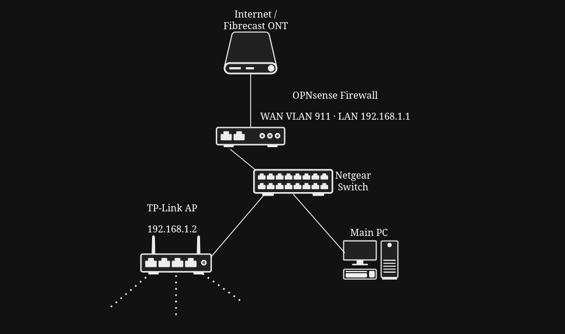

# opnsense-home-network-lab
Home networking and cybersecurity lab using OPNsense, VLANs, DHCP, firewall routing and Wi-Fi access point configuration.
# OPNsense Home Network & Firewall Lab

## Project Overview

## Network Topology

This project documents my experience replacing an ISP-provided router with a dedicated OPNsense firewall running on a mini-PC.

The aim was to gain practical experience in network administration, firewall configuration, VLAN tagging, DHCP, routing, and troubleshooting.

## Hardware & Software

- **Firewall:** Mini-PC running OPNsense 25.7
- **Internet connection:** Fibrecast fibre broadband
- **Switch:** Netgear 5-port Ethernet switch
- **Wireless access point:** TP-Link EX520v Wi-Fi 6 router configured as an access point
- **Client devices:** Laptop, smartphone, PC, Raspberry Pi, Amazon Fire TV Stick

## Network Configuration

| Component | Configuration |
|---|---|
| WAN interface | igc0 |
| WAN VLAN | 911 (802.1Q) |
| WAN addressing | DHCP |
| LAN interface | igc1 |
| LAN gateway | 192.168.1.1/24 |
| DHCP server | Dnsmasq |
| DHCP range | 192.168.1.100–192.168.1.200 |
| Wi-Fi access point | 192.168.1.2 |

## Implementation Checklist

- [x] Installed and configured OPNsense
- [x] Assigned WAN and LAN interfaces
- [x] Configured ISP-required VLAN 911
- [x] Obtained WAN connectivity using DHCP
- [x] Troubleshot and removed an incorrect LAGG configuration
- [x] Verified internet connectivity using ping and traceroute
- [x] Configured LAN addressing and DHCP
- [x] Connected a Netgear Ethernet switch
- [x] Repurposed a TP-Link EX520v as a wireless access point
- [x] Disabled DHCP on the TP-Link to avoid conflicting DHCP servers
- [x] Verified wired and wireless internet connectivity
- [x] Successfully tested YouTube casting to an Amazon Fire TV Stick

## Troubleshooting Experience

One of the main challenges was establishing WAN connectivity through the ISP-required VLAN 911.

I discovered that the WAN interface was incorrectly associated with a LAGG interface, preventing the VLAN from attaching to the correct physical interface.

After removing the LAGG configuration and restarting OPNsense, I verified that VLAN 911 was attached correctly and confirmed internet connectivity.

## Skills Demonstrated

- Firewall deployment and administration
- TCP/IP networking and subnetting
- IEEE 802.1Q VLAN tagging
- DHCP configuration
- Routing and NAT
- Ethernet switching
- Wireless access point configuration
- Network troubleshooting

## Future Improvements

- [ ] Implement network segmentation using VLANs
- [ ] Configure inter-VLAN firewall rules
- [ ] Deploy Suricata IDS/IPS
- [ ] Configure firewall logging and monitoring
- [ ] Implement secure remote VPN access
- [ ] Create and document firewall configuration backups
- [ ] Add network topology diagrams and screenshots

## Project Status

**Phase 1 complete:** OPNsense successfully deployed as the main home router and firewall, providing internet connectivity to wired and wireless clients.
