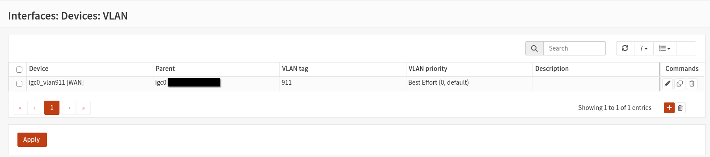

# 02 — WAN and VLAN Configuration

### Configuration Evidence



## Objective

Configure the OPNsense firewall to establish a direct internet connection through the Fibrecast Optical Network Terminal (ONT), replacing the ISP-provided TP-Link EX520v router.

This required identifying the ISP's WAN configuration requirements and implementing IEEE 802.1Q VLAN tagging.

## 1. Identifying ISP Requirements

Before configuring the WAN interface, I contacted Fibrecast to confirm whether third-party routers were supported.

The ISP confirmed the following requirements:

| Setting | Requirement |
|---|---|
| Connection type | DHCP / IPoE |
| VLAN tagging | Required |
| VLAN ID | 911 |
| VLAN protocol | IEEE 802.1Q |
| PPPoE authentication | Not required |
| MAC address locking | Not enforced |

This information was necessary because simply connecting the OPNsense WAN interface to the ONT was insufficient without the correct VLAN configuration.

## 2. Physical Network Configuration

The mini-PC was connected as follows:

```text
Internet
   |
Fibrecast ONT
   |
igc0 (Physical WAN)
   |
VLAN 911 (igc0_vlan911)
   |
OPNsense Firewall
   |
igc1 (LAN)
   |
Netgear Switch
   |
Internal Network
```

The physical WAN interface was `igc0`, while the LAN interface was `igc1`.

## 3. Creating the WAN VLAN

Using the OPNsense web interface, I navigated to:

**Interfaces → Devices → VLAN**

I configured the VLAN with the following settings:

| Setting | Value |
|---|---|
| Parent interface | `igc0` |
| VLAN tag | `911` |
| VLAN priority | Best Effort (0) |
| VLAN interface | `igc0_vlan911` |

The VLAN interface was assigned to WAN, with IPv4 configuration set to DHCP.

### Configuration Evidence


## 4. Troubleshooting — VLAN Parent Interface

### Problem

During the initial configuration, the WAN interface was unable to establish the expected connection.

Investigation showed that the VLAN interface was not correctly attached to its physical parent interface.

Using the OPNsense shell, I inspected the interface configuration:

```sh
ifconfig igc0_vlan911
```

The output indicated that the VLAN interface had no valid parent interface.

### Root Cause

Further investigation revealed that the physical WAN interface `igc0` was associated with an unexpected Link Aggregation Group (`lagg0`).

This interfered with the intended VLAN configuration.

### Resolution

To resolve the issue, I:

1. Removed `igc0` from the LAGG configuration.
2. Deleted the unused `lagg0` device through the OPNsense web interface.
3. Verified the VLAN configuration.
4. Rebooted OPNsense to confirm the changes persisted.

Afterward, the VLAN interface correctly referenced `igc0` as its parent.

The expected interface configuration included:

```text
vlan: 911
vlanproto: 802.1q
parent interface: igc0
```

## 5. Verifying WAN Connectivity

Once the VLAN issue was resolved, OPNsense successfully obtained a public IPv4 address through DHCP.

I performed several network connectivity tests.

### Default Gateway

I checked the routing table to confirm that a default route existed through the ISP gateway.

```sh
netstat -rn
```

### Gateway Connectivity

I used `ping` to verify connectivity to the ISP's default gateway.

```sh
ping -c 4 <ISP_GATEWAY>
```

The gateway responded successfully.

### External Connectivity

I then tested connectivity to an external IP address:

```sh
ping -c 4 8.8.8.8
```

I also used traceroute to investigate the path to the external destination:

```sh
traceroute 8.8.8.8
```

The traceroute successfully reached the destination, confirming upstream routing.

Finally, I verified internet access from a laptop connected to the OPNsense LAN.

## 6. Lessons Learned

This stage provided practical experience in:

- Understanding ISP-specific WAN configuration requirements.
- Configuring IEEE 802.1Q VLAN tagging.
- Distinguishing physical interfaces from VLAN interfaces.
- Identifying incorrect interface associations.
- Understanding how LAGG configuration can affect network connectivity.
- Troubleshooting WAN connectivity using interface inspection, routing tables, ping, and traceroute.
- Verifying configuration persistence after a reboot.

## 7. Outcome

The WAN configuration was successfully completed.

OPNsense established a direct connection to Fibrecast using VLAN 911 and DHCP, allowing the mini-PC to replace the original ISP router.

The next stage involved configuring the internal [LAN and DHCP address allocation](03-LAN-DHCP-Configuration.md) and wired network connectivity.
