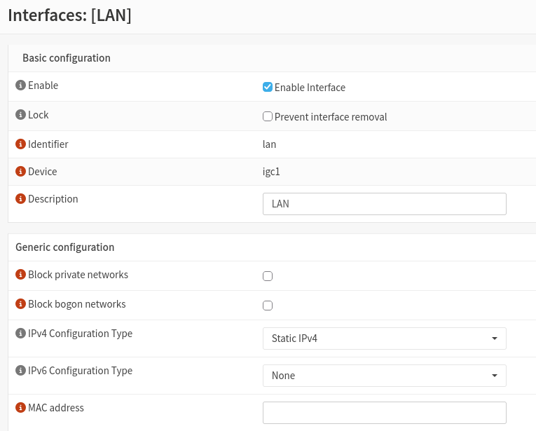
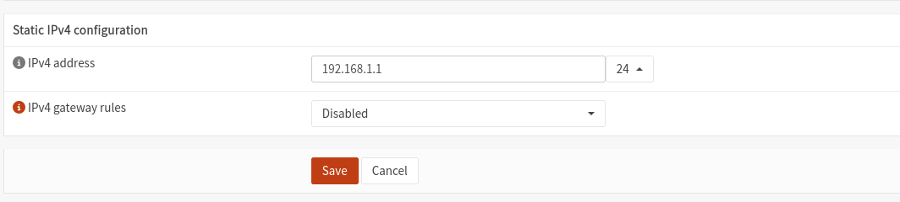
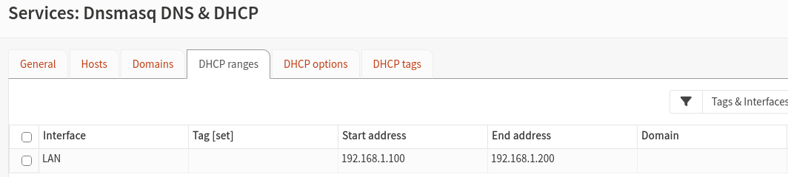

# 03 — LAN and DHCP Configuration

## Objective

Configure the internal home network using OPNsense as the default gateway and DHCP server, allowing wired and wireless devices to communicate and access the internet.

## 1. LAN Interface Configuration

I configured the OPNsense LAN interface with a static IPv4 address.

| Setting | Configuration |
|---|---|
| Physical interface | `igc1` |
| LAN IP address | `192.168.1.1` |
| Subnet mask | `/24` |
| Network address | `192.168.1.0/24` |
| Default gateway for clients | `192.168.1.1` |

This configuration provides a single internal subnet for my home network.

### LAN Configuration Evidence


**LAN Interface Assignment**



**Static IPv4 Configuration**



## 2. DHCP Configuration

I used the Dnsmasq DHCP service in OPNsense to dynamically assign IPv4 addresses to network clients.

The DHCP address pool was configured as follows:

| Setting | Value |
|---|---|
| DHCP service | Dnsmasq |
| Interface | LAN |
| Start address | `192.168.1.100` |
| End address | `192.168.1.200` |
| Reserved infrastructure addresses | Outside the DHCP pool |

Keeping infrastructure devices outside the DHCP pool reduces the risk of address conflicts.

For example, OPNsense uses `192.168.1.1` and the TP-Link access point uses `192.168.1.2`.

### DHCP Configuration Evidence



## 3. Ethernet Switch Integration

I connected a Netgear Ethernet switch to the OPNsense LAN interface.

The switch provides additional Ethernet connectivity for wired devices.

```text
OPNsense Firewall
LAN: 192.168.1.1
        |
   Netgear Switch
        |
   +----+------+
   |           |
Laptop      TP-Link AP
```

The switch operates at Layer 2, forwarding Ethernet frames between connected devices.

OPNsense remains responsible for routing traffic between the internal network and the internet.

## 4. Connectivity Testing

I tested the LAN configuration by connecting a laptop to the Netgear switch.

The laptop successfully accessed the OPNsense management interface and connected to the internet.

Additional tests confirmed that wireless devices could also access the internet through the TP-Link access point.

## 5. Skills Demonstrated

- IPv4 addressing and subnetting
- LAN interface configuration
- DHCP address pool management
- Layer 2 Ethernet switching
- Default gateway configuration
- Wired and wireless network connectivity testing

## 6. Outcome

The LAN was successfully configured using the `192.168.1.0/24` network.

OPNsense provides the internal network gateway and DHCP services, while the Netgear switch connects wired devices and the wireless access point.

The next stage documents the TP-Link EX520v access point configuration.
