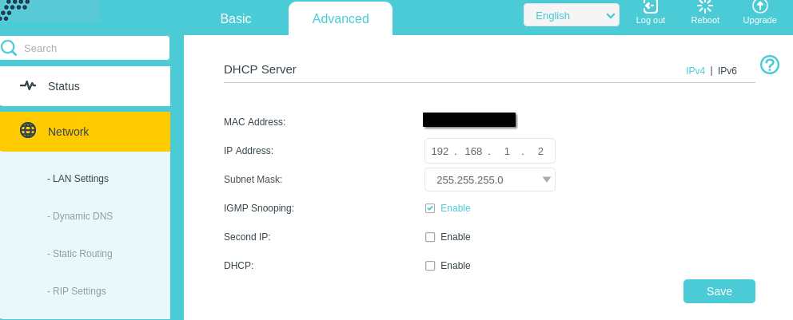
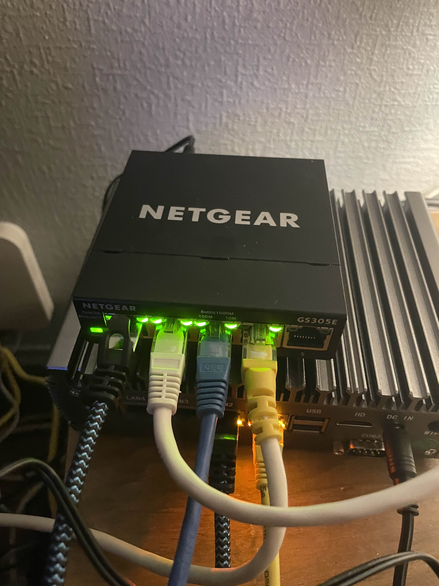
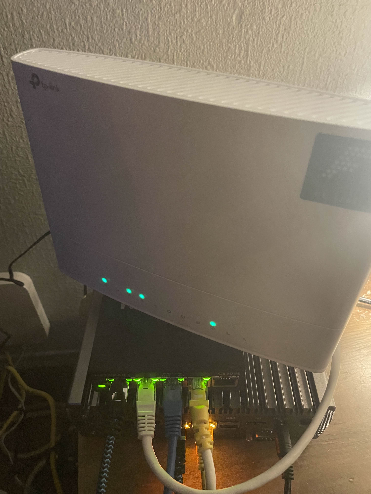

# 04 — Wireless Access Point Configuration

## Objective

Repurpose my ISP-provided TP-Link EX520v Wi-Fi 6 router as a wireless access point while using OPNsense as the primary router, firewall, and DHCP server.

This allows wireless devices to connect to the existing home network without introducing a second routed network.

## 1. Hardware

| Device | Purpose |
|---|---|
| OPNsense mini-PC | Router, firewall and LAN gateway |
| Netgear Ethernet switch | Connects wired network devices |
| TP-Link EX520v | Wireless access point |
| Smartphone | Wireless connectivity testing |
| Amazon Fire TV Stick | Wireless connectivity and casting testing |

## 2. Network Topology

```text
             OPNsense
          192.168.1.1/24
                 |
           Netgear Switch
                 |
          TP-Link EX520v
           192.168.1.2
                 |
              Wi-Fi
                 |
       +---------+---------+
       |                   |
   Smartphone         Fire TV Stick
```

## 3. Access Point Configuration

I accessed the TP-Link EX520v management interface and manually configured it to operate as a wireless access point.

The following settings were applied:

| Setting | Configuration |
|---|---|
| Device | TP-Link EX520v |
| LAN IP address | `192.168.1.2` |
| Subnet mask | `255.255.255.0` |
| DHCP server | Disabled |
| Connection to switch | LAN Ethernet port |
| WAN port | Not used |
| Default LAN gateway | OPNsense (`192.168.1.1`) |

### Why DHCP Was Disabled

OPNsense was already configured to provide DHCP services using Dnsmasq.

Leaving DHCP enabled on the TP-Link could result in two DHCP servers assigning network settings to clients on the same LAN.

Disabling the TP-Link DHCP server ensures that OPNsense remains responsible for assigning IP addresses.

### Why the LAN Port Was Used

I connected the TP-Link to the Netgear switch using one of its LAN ports rather than its WAN port.

This allows the TP-Link to bridge wireless clients onto the existing internal network instead of creating another routed network.

## 4. Wireless Connectivity Testing

After saving the configuration and restarting the TP-Link, I connected wireless devices to the network.

I verified that:

- The wireless network was accessible.
- My laptop could access the internet over Wi-Fi.
- Wireless clients could use OPNsense as their default gateway.
- My smartphone successfully connected to the network.
- YouTube casting from my smartphone to an Amazon Fire TV Stick worked successfully.

The successful casting test also demonstrated that the phone and Fire TV Stick could communicate using the local network's supported discovery and application mechanisms.

## 5. Configuration Evidence

### TP-Link LAN Configuration



### Physical Hardware




## 6. Skills Demonstrated

- Wireless networking
- Access point configuration
- DHCP server management
- IPv4 addressing
- Layer 2 bridging
- LAN connectivity testing
- Troubleshooting device communication

## 7. Outcome

The TP-Link EX520v was successfully repurposed as a wireless access point.

OPNsense remains the primary router and firewall, while the TP-Link provides wireless connectivity to devices on the existing home network.
