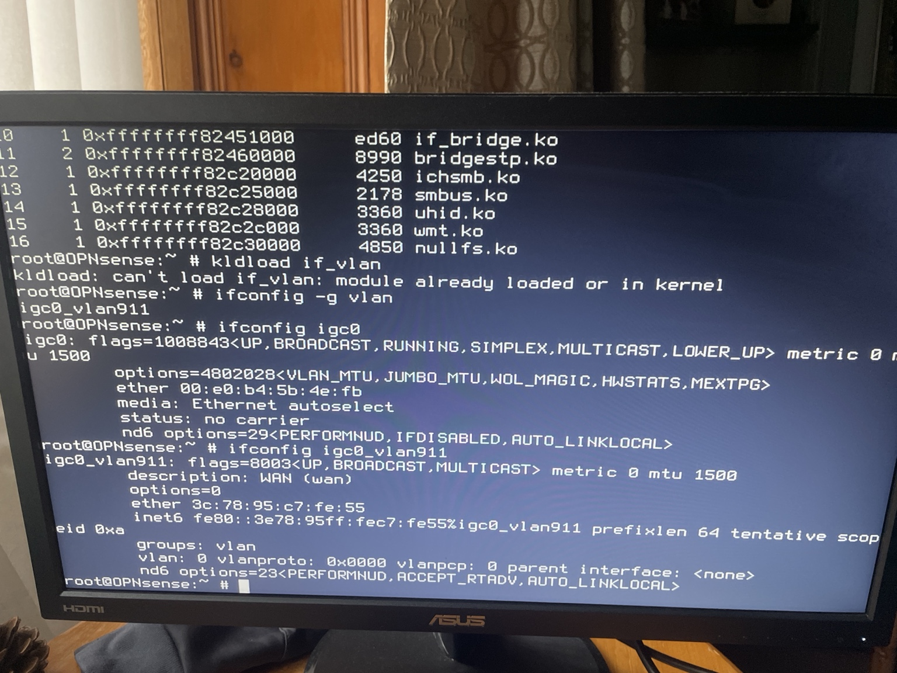
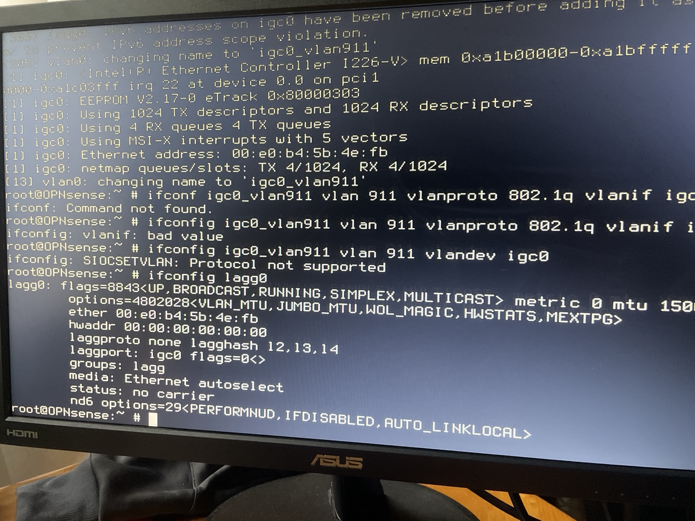
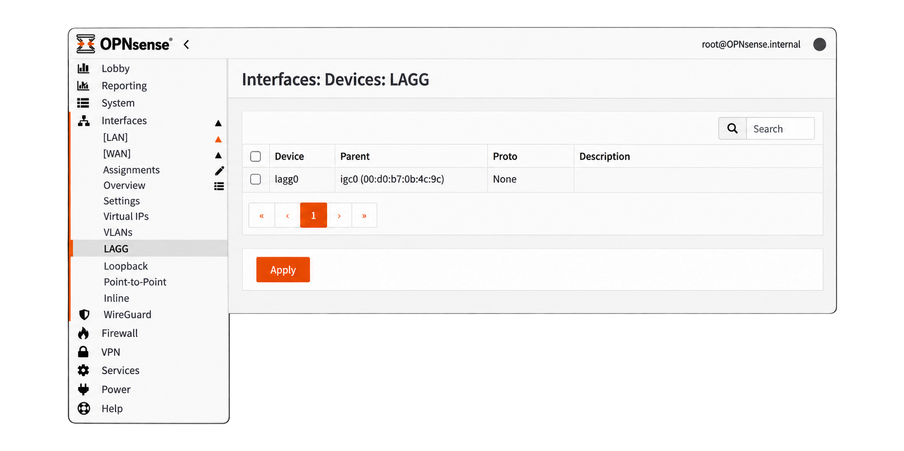
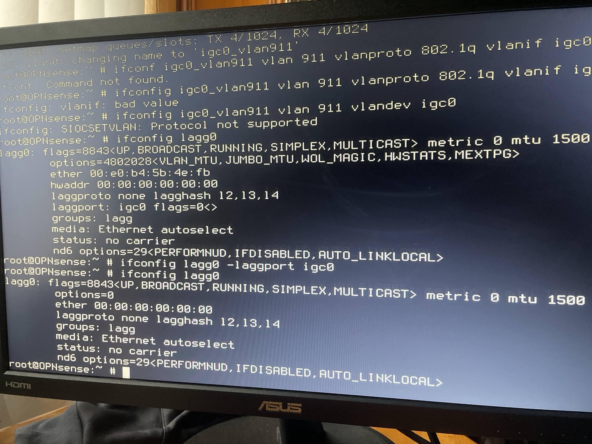
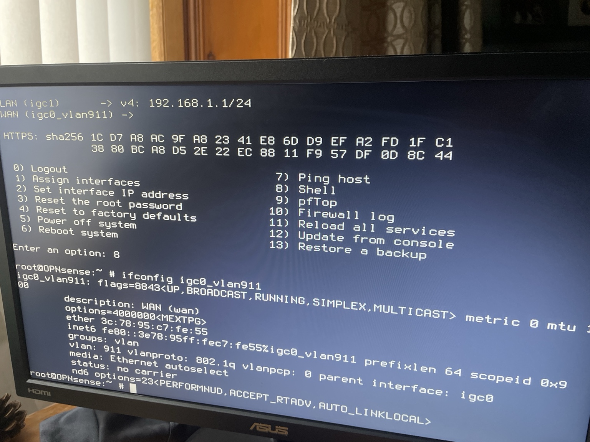

# 05 — Network Troubleshooting

## Objective

Document the networking problems encountered while replacing my ISP-provided router with OPNsense, including the investigation process, root causes, and solutions.

## 1. WAN VLAN Interface Not Working

### Problem

After configuring VLAN 911 for my Fibrecast connection, the WAN interface was not functioning as expected.

Although the physical Ethernet connection was active, the VLAN interface was not correctly associated with its parent interface.

### Investigation

I accessed the OPNsense shell and inspected the VLAN interface using:

```sh
ifconfig igc0_vlan911
```

The output indicated that the VLAN interface had no parent interface assigned.

```text
vlan: 0
parent interface: <none>
```

I then investigated the physical WAN interface and discovered that `igc0` was associated with a Link Aggregation Group (`lagg0`).

### Root Cause

The physical WAN interface had been included in an unexpected LAGG configuration, interfering with the intended VLAN setup.

### Resolution

I performed the following actions:

1. Removed `igc0` from the LAGG configuration.
2. Deleted the unused `lagg0` device in OPNsense.
3. Verified that VLAN 911 was assigned to `igc0`.
4. Rebooted OPNsense to verify the configuration persisted.

### Verification

### Troubleshooting Evidence

**1. Initial VLAN configuration failure**

The VLAN interface initially had no parent interface assigned.



**2. Identifying the root cause**

Using `ifconfig lagg0`, I discovered that the physical WAN interface `igc0` was a member of `lagg0`.



The OPNsense interface configuration also showed the unwanted LAGG device.



**3. Removing the interface from LAGG**

I removed `igc0` from `lagg0` using:

`ifconfig lagg0 -laggport igc0`

I then removed the unnecessary LAGG configuration through the OPNsense web interface.



**4. Verifying the solution**

After correcting the configuration, I checked the VLAN interface again.

The output confirmed that VLAN 911 was correctly attached to `igc0`.



After applying the changes, the VLAN interface correctly displayed:

```text
vlan: 911
vlanproto: 802.1q
parent interface: igc0
```

This confirmed that the VLAN was attached to the correct physical interface.

## 2. WAN Connectivity Troubleshooting

### Problem

After resolving the VLAN configuration issue, OPNsense obtained a public IPv4 address through DHCP, but internet connectivity was not initially working as expected.

### Investigation

I checked the default routing configuration and confirmed that a route existed through the ISP gateway.

I then performed connectivity tests using:

```sh
ping -c 4 <ISP_GATEWAY>
```

The ISP gateway responded successfully.

Next, I tested the route to an external IP address:

```sh
traceroute 8.8.8.8
```

The traceroute successfully reached the destination, confirming that upstream routing was functional.

### Resolution

After restarting OPNsense, I retested connectivity from a laptop connected to the LAN.

The laptop successfully accessed external websites and responded to ping tests.

The exact cause of the temporary client connectivity problem was not conclusively identified, so I recorded the restart and subsequent successful tests rather than attributing it to an unverified cause.

## 3. Wireless Access Point Configuration

### Challenge

The TP-Link EX520v was originally configured as the primary ISP router.

When introducing OPNsense as the new router, I needed to avoid running two DHCP servers on the same internal network.

### Resolution

I manually configured the TP-Link as a wireless access point:

| Setting | Configuration |
|---|---|
| TP-Link LAN IP | `192.168.1.2` |
| Subnet mask | `255.255.255.0` |
| DHCP server | Disabled |
| Ethernet connection | LAN-to-LAN through Netgear switch |
| Default gateway for clients | `192.168.1.1` |

This allowed wireless devices to connect to the existing OPNsense LAN.

### Verification

I successfully connected a laptop and smartphone to the wireless network and confirmed internet connectivity.

I also tested YouTube casting from my smartphone to an Amazon Fire TV Stick.

The casting test succeeded, demonstrating working communication between the devices.

## 4. Troubleshooting Tools and Techniques

| Tool or Technique | Purpose |
|---|---|
| `ifconfig` | Inspect network interface and VLAN configuration |
| `netstat -rn` | Inspect routing table |
| `ping` | Test network reachability |
| `traceroute` | Investigate network paths |
| OPNsense web interface | Configure and inspect network services |
| Client browser testing | Verify end-to-end internet access |
| Reboot verification | Check whether configuration changes persist |

## 5. Lessons Learned

This project reinforced several important networking concepts:

- A physically connected interface does not guarantee correct logical network configuration.
- VLAN tagging must match the ISP's requirements.
- Unexpected LAGG membership can interfere with interface configuration.
- Successful DHCP address assignment does not necessarily prove end-to-end internet access.
- Troubleshooting should distinguish interface, routing, and client connectivity problems.
- Only one intended DHCP service should serve a given LAN.
- Configuration changes should be verified through testing rather than assumed to work.

## 6. Outcome

The network was successfully deployed with OPNsense as the main firewall and router.

The completed troubleshooting demonstrated practical experience in diagnosing interface configuration problems, validating routing, and restoring network connectivity.
